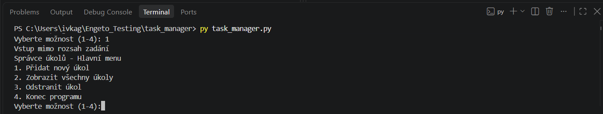
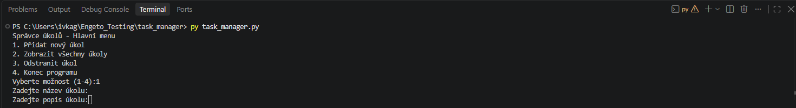
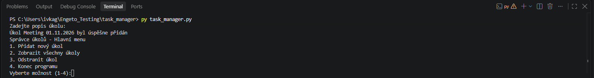

###  🐛 BUG-00X VZOR

- **Popis:**
- **Súvisiaci testovací prípad:**
- **Vstupné podmienky:**
- **Testovacie dáta:**
- **Testovacie kroky:**
- **Očakávaný výsledok:**
- **Skutočný výsledok:**
- **Prílohy:**

###  🐛 BUG-001 Platný číselný vstup s medzerou

- **Popis:** Aplikácia vyhodnocuje platný číselný vstup s medzerou ako neplatný údaj.
- **Súvisiaci testovací prípad:** HM-07
- **Vstupné podmienky:** Úspešný SMOKE TEST APP-01, spustená aplikácia a zobrazené hlavné menu
- **Testovacie dáta:** " 1 ", " 2 ", " 3 ", " 4 "

- **Testovacie kroky:**

1. Do vstupného poľa "Vyberte možnost (1-4)" vložíme " 1 " (s medzerou za a pred číslovkou).
2. Našu voľbu potvrdíme klávesou enter.
3. Rovnaký postup zopakujeme aj s ostatnými testovacími údajmi.

- **Očakávaný výsledok:**
Program odignoruje/ odstráni zbytočné medzery a spustí jednotlivé funkcionality aplikácie 1-4, tak ako je uvedené v testovacích prípadoch HM-01 až HM-04.

- **Skutočný výsledok:**
Aplikácia neakceptuje vstupy (1-4) v platnom rozsahu, ale s medzerou. Aplikácia vyhodnotí vstup s medzerou ako neplatný vsetup a zobrazí chybovú hlášku "Vstup mimo rozsah zadání".

- **Prílohy:**

###  🐛 BUG-002 medzera ako platný vstup v názve

- **Popis:** Aplikácia spracuje medzeru ako platný vstup
- **Súvisiaci testovací prípad:** PU-05
- **Vstupné podmienky:** Úspešný SMOKE TEST APP-01, spustená aplikácia a zobrazené hlavné menu
- **Testovacie dáta:** N: " " (medzera)

- **Testovacie kroky:**
1. V hlavnom menu vyberieme možnosť 1 "Přidat nový úkol". 
2. Potom, čo nás aplikácie vyzve, aby sme vyplnili názov úlohy vložíme do poľa 1 medzeru.
3. Náš vstup potvrdíme klávesou enter.
4. Skontrolujeme, či aplikácia zobrazí chybovú hlášku "Pole nesmí být prázdné. Zadejte prosím název úkolu" a vyzve nás, aby sme názov zadali znova. 

- **Očakávaný výsledok:**

Aplikácia vyhodnotí medzeru ako neplatný vstup a zobrazí chybovú hlášku "Pole nesmí být prázdné. Zadejte prosím název úkolu". Aplikácia nám ponúkne možnosť znovu vložiť názov úlohy.

- **Skutočný výsledok:**

Aplikácia spracovala medzeru ako platný údaj a uložila ju ako názov úlohy. Aplikácia sa následne presunula k ďalšiemu kroku a vyzvala nás, aby sme zadali popis úlohy. 

- **Prílohy:**

###  🐛 BUG-003 Medzera ako platný vstup v popise

- **Popis:** Aplikácia prijíma medzeru ako platný vstup v popise novej úlohy
- **Súvisiaci testovací prípad:** PU-06
- **Vstupné podmienky:** Úspešný SMOKE TEST APP-01, spustená aplikácia a zobrazené hlavné menu
- **Testovacie dáta:** 
N: Meeting 01.11.2026
P: " " (medzera)

- **Testovacie kroky:**
1. V hlavnom menu vyberieme možnosť 1 "Přidat nový úkol"
2. Do poľa názov vložíme "Meeting 01.01.2026" a tento krok potvrdíme klávesou enter.
3. Do poľa popis vložíme iba medzeru a stlačíme enter. 
4. Skontrolujeme reakciu aplikácie.

**Očakávaný výsledok:**
Aplikácia nás potom, čo vyplníme pole názov posunie do ďalšieho kroku, kde do popisu úlohy vložíme iba samostatnú medzeru. Aplikácia zobrazí chybovú hlášku a vyzve nás, aby sme popis zadali znova. 

**Skutočný výsledok:**
Potom, čo sme vyplnili pole názov nás aplikácia správna nasmerovala k ďalšiemu kroku. Aplikácia po zadaní medzery do poľa popis nezobrazila chybovú hlášku a uložila prázdny popis.

- **Prílohy:**

