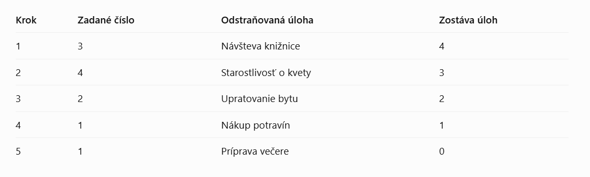
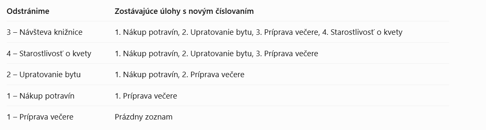

### APP-01 - Spustenie aplikácie v termináli 

- **Popis:** Overenie základnej funkčnosti aplikácie a zobrazenia hlavného menu

- **Vstupné podmienky:** spustený terminál

- **Postup:**
1. Otvor terminál
2. Spusti príkaz py task_manager.py
3. Skontroluj zobrazenie hlavného menu

- **Očakávaný výsledok:** 
Aplikácia sa spustí a zobrazí Hlavné menu s možnosťou výberu jednotlivých funkcionalít a ukončenia programu.

- **Skutočný výsledok:**
Spustenie aplikácie v termináli prebehlo bez problémov a chybových hlášok. Aplikácia zobrazila hlavné menu s možnosťou vyýberu jednotlivých funkcionalít a ukončenia programu. 

- **Stav:** pass

- **Poznámky:** -

### HM-01 – Možnosť 1 spustí pridanie úlohy

- **Popis:** Overujeme, že zadanie 1 spustí funkcionalitu "Přidat nový úkol"

- **Vstupné podmienky:** spustený terminál, úspešný smoke test APP-01

- **Postup:**
1. Do riadku Vyberte možnost (1-4): vložíme číslo 1
2. Potvrdíme naše zadanie klávesou enter

- **Očakávaný výsledok:** 
Program správne priradí vstup "1" od uživateľa k možnosti "Přidat nový úkol", spustí funkciu "Přidat nový úkol" a zobrazí výzvu "Zadejte název úkolu":

- **Skutočný výsledok:** 
Program správne spustil funkciu "Přidat nový úkol" a zobrazí výzvu "Zadejte název úkolu:"

- **Stav:** pass

- **Poznámky:** -

### HM-02 – Možnosť 2 Zobraziť všechny úkoly

- **Popis:** Overujeme, že po vložení číslovky 2 program správne zareaguje a spustí funkcionalitu "Zobrazit všechny úkoly"

- **Vstupné podmienky:** spustený terminál, úspešný test APP-001

- **Postup:** 
1. Do riadku Vyberte možnost (1-4): vložíme číslovku "2"
2. Potvrdíme našu voľbu klávesou enter

- **Očakávaný výsledok:** 
Program správne priradí vstup "2" od užívateľa k funkcionalite "Zobrazit všechny úkoly". Nakoľko ešte nevyužívame testovacie data, aplikácia zobrazí hlášku: "Seznam úkolů je prázdný". Program nám ponúkne opäť možnosť vybrať jednu z možností.

- **Skutočný výsledok:** 
Program správne priradil vstup "2" od užívateľa k funkcionalite "Zobrazit všechny úkoly". Nakoľko ešte nevyužívame testovacie data, aplikácia zobrazila hlášku: "Seznam úkolů je prázdný".
Program nám ponúkol opäť možnosť vybrať jednu z možností.

- **Stav:** pass

- **Poznámky:** Testujeme zatiaľ iba základnú fukčnosť, teda predovšetkým či menu správne prijíma vstupy 1-4 od užívateľa. Podrobnejšie budeme funkcionalitu pomocou testovacích dát testovať až pri testoch jednotlivých funkcionalít. 

### HM-03 – Možnosť 3 Odstranit úkol

- **Popis:** Overujeme, že po vložení číslovky 3 program správne zareaguje a spustí funkcionalitu "odstranit úkol"

- **Vstupné podmienky:** spustený terminál, úspešný test APP-001

- **Postup:** 
1. Do riadku Vyberte možnost (1-4): vložíme číslovku "3"
2. Potvrdíme našu voľbu klávesou enter

- **Očakávaný výsledok:** 
Program správne priradí vstup "3" od užívateľa k funkcionalite "Odstranit úkol". Nakoľko ešte nevyužívame testovacie data, aplikácia zobrazí hlášku: "Seznam úkolů je prázdný". Program nám ponúkne opäť možnosť vybrať jednu z možností.

- **Skutočný výsledok:** 
Program správne priradil vstup "3" od užívateľa k funkcionalite "Odstranit ůkol". Nakoľko ešte nevyužívame testovacie data, aplikácia zobrazila hlášku: "Seznam úkolů je prázdný".
Program nám ponúkol opäť možnosť vybrať jednu z možností.

- **Stav:** pass

- **Poznámky:** 
Testujeme zatiaľ iba základnú fukčnosť, teda predovšetkým či menu správne prijíma vstupy 1-4 od užívateľa. Podrobnejšie budeme funkcionalitu pomocou testovacích dát testovať až pri testoch jednotlivých funkcionalít. 

### HM-04 - Možnosť 4 Konec programu

- **Popis:** Overujeme, že po vložení číslovky 4 program správne zareaguje a spustí správnu funkcionalitu, teda ukončenie programu. 

- **Vstupné podmienky:** spustený terminál, úspešný test APP-001

- **Postup:** 
1. Do riadku Vyberte možnost (1-4): vložíme číslovku "4"
2. Potvrdíme našu voľbu klávesou enter

- **Očakávaný výsledok:** 
Program správne priradí vstup "4" od užívateľa k funkcionalite "Konec programu". Aplikácia zobrazí hlášku: "Konec programu.". 

- **Skutočný výsledok:** 
Program správne priradil vstup "4" od užívateľa k funkcionalite "Konec programu". Aplikácia zobrazila hlášku: "Konec programu".

- **Stav:** pass

- **Poznámky:** -

### HM-05 - Zadanie neplatnej číselnej možnosti mimo číselný rozsah hlavného menu

- **Popis:**
Overujeme ako aplikácia zareaguje po zadaní číslovky mimo platný číselný rozsah hlavného menu

- **Vstupné podmienky:**
Úspešný SMOKE TEST APP-01, spustená aplikácia a zobrazené hlavné menu

- **Testovacie dáta:**
5, 0, -2, 3.5

- **Postup:**
1. Do vstupného poľa "Vyberte možnost (1-4)" vložíme číslovku 5.
2. Našu voľbu potvrdíme klávesou enter.
3. Rovnaký postup zopakujeme u čísloviek 0,-2 a 3.5.

- **Očakávaný výsledok:**
Potom, čo do poľa vložíme neplatné údaje nás aplikácia vo všetkým troch prípadoch upozorní prostredníctvom chybovej hlásky "Vstup mimo rozsah zadání" a nechá nás voľbu znovu zopakovať.

- **Skutočný výsledok:**
Po vložení neplatných údajov nás aplikácia upozornila na zadanie neplatných údajov zobrazila chybovú hlášku "Vstup mimo rozsah zadání".

- **Stav:** pass
- **Poznámka:** -

### HM-06 - Zadanie neplatného nečíselného vstupu ako možnosť výberu v hlavnom menu

- **Popis:**
Overujeme správnu reakciu aplikácie po vložení nesprávneho nečísleného vstupu, potom čo nás aplikácia vyzve, aby sme vybrali jednu z možností, ktorú nám ponúka hlavné menu aplikácie.

- **Vstupné podmienky:**
Úspešný SMOKE TEST APP-01, spustená aplikácia a zobrazené hlavné menu

- **Testovacie dáta:**
abecedné znaky: abc
špeciálne znaky: @÷ß
prázdna medzera
prázdny vstup

- **Postup:**
1. Do vstupného poľa "Vyberte možnost (1-4)" vložíme abecedné znaky: abc.
2. Našu voľbu potvrdíme klávesou enter.
3. Rovnaký postup zopakujeme u ostatných nečíslených vstupov uvedených v testovacích dátach.

- **Očakávaný výsledok:**
Potom, čo do poľa vložíme neplatné údaje nás aplikácia vo všetkým štyroch prípadoch upozorní prostredníctvom chybovej hlásky "Vstup mimo rozsah zadání" a nechá nás voľbu znovu zopakovať.

- **Skutočný výsledok:**
Po vložení neplatných údajov nás aplikácia upozornila na zadanie neplatných údajov zobrazila chybovú hlášku "Vstup mimo rozsah zadání".

- **Stav:** pass
- **Poznámka:** -

### HM-07 - Zadanie platného číselného vstupu s medzerou pred a za číslovkou pri výbere z hlavného menu

- **Popis:**
Overujeme, či je aplikácia schopná správne spracovať a vyhodnotiť platné číselné údaje s medzerou.

- **Vstupné podmienky:**
Úspešný SMOKE TEST APP-01, spustená aplikácia a zobrazené hlavné menu

- **Testovacie dáta:**
" 1 ", " 2 ", " 3 ", " 4 "

- **Postup:**
1. Do vstupného poľa "Vyberte možnost (1-4)" vložíme " 1 " (s medzerou za a pred číslovkou).
2. Našu voľbu potvrdíme klávesou enter.
3. Rovnaký postup zopakujeme aj s ostatnými testovacími údajmi.

- **Očakávaný výsledok:**
Program odignoruje/ odstráni zbytočné medzery a spustí jednotlivé funkcionality aplikácie 1-4, tak ako je uvedené v testovacích prípadoch HM-01 až HM-04.

- **Skutočný výsledok:**
Aplikácia neakceptuje vstupy (1-4) v platnom rozsahu, ale s medzerou. Aplikácia vyhodnotí vstup s medzerou ako neplatný vstup a zobrazí chybovú hlášku "Vstup mimo rozsah zadání".

- **Poznámka:**V zadaní nebolo správanie aplikácie pre tento prípad presne definované, avšak vzhľadom k uživateľskej prívetivosti by mala byť v takomto prípade aplikácia schopná medzery ignorovať a správne vyhodnotiť požiadavku uživateľa na vstup.

- **Stav:** failed
- **Poznámka:** - 

### PU-01 - Test funkcionality Přidat nový úkol po zadaní platného vstupu

- **Popis:**
Overenie, že funkcionalita "Přidat nový úkol" funguje správne po zadaní platných vstupných údajov (názov a popis), v tomto prípade sa jedná o abecedné znaky, ku ktorým budeme postupne pridávať medzery, číslovky a špeciálne znaky

- **Vstupné podmienky:**
Úspešný SMOKE TEST APP-01, spustená aplikácia a zobrazené hlavné menu

- **Testovacie dáta:**  
TD1
N:Upratovanie  P: Povysávať

TD2
N:Vyniesť smeti P: Plasty, sklo a bio

TD3
N:Upratať byt! P: Umyť podlahy!!!

TD4
N:Nákup 2 P: 3 kartóny pracieho prášku

- **Postup:**
1. Z hlavného menu vyberieme možnosť 1 "Přidat nový úkol".
2. Postupne zadáme názov a popis nového úkolu, ktoré potvrdíme klávesou enter
3. Aplikácia zobrazí hlášku "Úkol XY byl úspěšně přidán".
4. Prostredníctvom funkcionality 2 Zobrazit všechny úkoly skontrolujeme, či sa úlohy a ich popis zobrazia v zozname úloh.

- **Očakávaný výsledok:**
 Aplikácia správne spracuje zadané vstupy - názov a popis a zobrazí potvrdzovaciu hlášku. Po pridaní úlohy a jej popisu sa po vybraní možnosti dva zobrazí zoznam úloh a ich popis. 

 - **Skutočný výsledok:**
 Aplikácia správne spracovala všetky zadané vstupy názvy aj popisy a zobrazila potvrdzovaciu hlášku. Následne sa po vybraní možnosti 2 zobrazil zoznam všetkých zadaných úloh a ich popis.

 - **Stav:** passed
 - **Poznámky:** Testovací prípad PU-01 sme využili aj na odtestovanie správneho formátu zoznamu úkolov a ich popisu. Názov aj popis vrátane číslovania zobrazila aplikácia správne. vo formáte Poradové číslo. Názov - Popis

### PU-02 - Test funkcionality Přidat nový úkol po zadaní platného vstupu - špeciálne znaky

- **Popis:**
Overujeme, že aplikácia dokáže spracovať špeciálne znaky bez toho, aby bola obmedzená jej funkčnosť a stabilita. 

- **Vstupné podmienky:**
Úspešný SMOKE TEST APP-01, spustená aplikácia a zobrazené hlavné menu

- **Testovacie dáta:**
1. TD1
N: @/()-*§
P: Kúpiť mlieko, maslo, syr

2. TD2
N: Upratať si izbu
P: /#?<>

- **Postup:**

1. V hlavnom menu vyberieme možnosť 1 "Přidat nový úkol".
2. Postupne zadáme názov a popis nového úkolu, ktoré potvrdíme klávesou enter
3. Aplikácia zobrazí hlášku "Úkol XY byl úspěšně přidán".
4. Prostredníctvom funkcionality 2 Zobrazit všechny úkoly skontrolujeme, či sa úlohy a ich popis zobrazia v zozname úloh.

- **Očakávaný výsledok:**
 Aplikácia správne spracuje zadané vstupy - názov a popis a zobrazí potvrdzovaciu hlášku. Po pridaní úlohy a jej popisu sa po vybraní možnosti dva zobrazí zoznam úloh a ich popis. 

- **Skutočný výsledok:**
 Aplikácia správne spracovala všetky zadané vstupy názvy aj popisy a zobrazila potvrdzovaciu hlášku. Následne sa po vybraní možnosti 2 zobrazil zoznam všetkých zadaných úloh a ich popis.

- **Stav:** passed

- **Poznámka:** Nakoľko zadanie neobmedzuje využívanie špeciálnych znakov, považujeme za dôležité otestovať, či ich použitie neovplyvní stabilitu,  správanie aplikácie a hladké spracovanie dát, aj keď nepredpokladáme, že vstupy od uživateľa budú pozostávať výlučne zo špeciálnych znakov. 

### PU-03 - Test funkcionality Přidat nový úkol po zadaní neplatného vstupu - prázdny reťazec v poli Název 

- **Popis:**
Overujeme, či bude aplikácia správne reagovať v prípade, že nevyplníme jedno z povinných polí - název

- **Vstupné podmienky:**
Úspešný SMOKE TEST APP-01, spustená aplikácia a zobrazené hlavné menu

- **Testovacie dáta:**
N: (pole zostáva prázdne)

- **Postup:**
1. V hlavnom menu vyberieme možnosť 1 "Přidat nový úkol".
2. Pole Zadejte název úkolu nevyplníme
3. Potvrdíme klávesou enter
4. Aplikácia zobrazí chybovú hlášku "Pole nesmí být prázdné. Zadejte prosím název úkolu"

- **Očakávaný výsledok:**
Potom, čo nevyplníme pole Zadejte název úkolu zobrazí aplikácia chybovú hlášku "Pole nesmí být prázdné. Zadejte prosím název úkolu" a aplikácia nás znova vyzve, aby sme zadali názov úlohy. Popis úlohy nebude možné zadať, nakoľko nám chýba jej názov.

- **Skutočný výsledok:**
Aplikácia správne vyhodnotila prázdne pole Název a zobrazila chybovú hlášku "Pole nesmí být prázdné. Zadejte prosím název úkolu". Aplikácia nás opäť vyzvala, aby sme zadali názov úlohy a ďalší krok, teda zadanie popisu neprebehol.

- **Stav:** Passed
- **Poznámka:** Potom, čo nás program opätovne vyzval k zadaniu názvu úlohy fungoval program správne a nevyskytli sa žiadne chyby a program fungoval presne ako v PU-01.

### PU-04 - Test funkcionality Přidat nový úkol po zadaní neplatného vstupu - prázdny reťazec v poli Popis

- **Popis:**
Overujeme ako bude aplikácia reagovať pokiaľ vynecháme popis

- **Vstupné podmienky:**
Úspešný SMOKE TEST APP-01, spustená aplikácia a zobrazené hlavné menu

- **Testovacie dáta:**
N: Meeting práca
P: (Pole zostáva prázdne)

- **Postup:**
1. V hlavnom menu vyberieme možnosť 1 "Přidat nový úkol". 
2. Do poľa názov vložíme "Meeting práca"
3. Pole popis zostane prázdne
4. Potvrdíme klávesou enter
5. Skontrolujeme, či program zobrazil chybovú hlášku "Pole nesmí být prázdné. Zadejte prosím popis úkolu" a vyzval nás, aby sme popis úlohy zadali znova.

- **Očakávaný výsledok:**
Potom, čo vynecháme pole popis a nevyplníme ho, program správne zobrazí chybovú hlášku "Pole nesmí být prázdné. Zadejte prosím popis úkolu" a vyzve nás, aby sme popis úlohy zadali znova.

- **Skutočný výsledok:**
Porgram správne zobrazil chybovú hlášku a vyzval nás k opätovnému zadaniu popisu úlohy, nakoľko toto pole nesmie zostať prázdne. 

- **Stav:** passed

- **Poznámka:** Potom, čo nás program opätovne vyzval k zadaniu popisu úlohy fungoval program správne a nevyskytli sa žiadne chyby a program fungoval presne ako v PU-01.

### PU-05 - Test funkcionality Přidat nový úkol po zadaní neplatného vstupu - medzera " " ako názov úlohy

- **Popis:**
Overujeme ako bude aplikácia reagovať po vložení samostatnej medzery do poľa názov.

- **Vstupné podmienky:**
Úspešný SMOKE TEST APP-01, spustená aplikácia a zobrazené hlavné menu

- **Testovacie dáta:**
N: " " (medzera)

- **Postup:**
1. V hlavnom menu vyberieme možnosť 1 "Přidat nový úkol". 
2. Potom, čo nás aplikácie vyzve, aby sme vyplnili názov úlohy vložíme do poľa 1 medzeru.
3. Náš vstup potvrdíme klávesou enter.
4. Skontrolujeme, či aplikácia zobrazí chybovú hlášku "Pole nesmí být prázdné. Zadejte prosím název úkolu" a vyzve nás, aby sme názov zadali znova. 

- **Očakávaný výsledok:**
Aplikácia vyhodnotí medzeru ako neplatný vstup a zobrazí chybovú hlášku "Pole nesmí být prázdné. Zadejte prosím název úkolu". Aplikácia nám ponúkne možnosť znovu vložiť názov úlohy.

- **Skutočný výsledok:**
Aplikácia spracovala medzeru ako platný údaj a uložila ju ako názov úlohy. Aplikácia sa následne presunula k ďalšiemu kroku a vyzvala nás, aby sme zadali popis úlohy. 

- **Stav:** failed

### PU-06 Test funkcionality Přidat nový úkol po zadaní neplatného vstupu - medzera " " do poľa popis

- **Popis:**
Overujeme ako bude aplikácia reagovať a fungovať potom, čo do poľa popis vložíme iba samostatnú medzeru

- **Vstupné podmienky:**
Úspešný SMOKE TEST APP-01, spustená aplikácia a zobrazené hlavné menu

- **Testovacie dáta:**
N: Meeting 01.11.2026
P: " " (medzera)

- **Postup:**
1. V hlavnom menu vyberieme možnosť 1 "Přidat nový úkol".
2. Do poľa názov vložíme "Meeting 01.01.2026" a tento krok potvrdíme klávesou enter.
3. Do poľa popis vložíme iba medzeru a stlačíme enter. 
4. Skontrolujeme reakciu aplikácie.

**Očakávaný výsledok:**
Aplikácia nás potom, čo vyplníme pole názov posunie do ďalšieho kroku, kde do popisu úlohy vložíme iba samostatnú medzeru. Aplikácia zobrazí chybovú hlášku a vyzve nás, aby sme popis zadali znova. 

**Skutočný výsledok:**
Potom, čo sme vyplnili pole názov nás aplikácia správna nasmerovala k ďalšiemu kroku. Aplikácia po zadaní medzery do poľa popis nezobrazila chybovú hlášku a uložila prázdny popis.

**Stav:** failed

### PU-07 Test funkcionality Přidat nový úkol - nadmerne dlhý vstup v poli název

- **Popis:**
Overujeme ako bude aplikácia reagovať po zadaní vstupu do poľa názov, ktorý bude obsahovať nadmerné množstvo znakov

- **Vstupné podmienky:**
Úspešný SMOKE TEST APP-01, spustená aplikácia a zobrazené hlavné menu

- **Testovacie dáta:**
N: Upratať celý byt vrátane obývacej izby spálne kuchyne kúpeľne chodby a balkóna povysávať všetky koberce umyť podlahy vyčistiť okná utrieť prach zo všetkých políc usporiadať knihy v knižnici vytriediť staré dokumenty skontrolovať zásoby čistiacich prostriedkov vyprať posteľnú bielizeň vymeniť uteráky vyčistiť kuchynskú linku umyť všetok riad vyčistiť chladničku a mrazničku skontrolovať dátumy spotreby potravín vyhodiť nepotrebné veci upratať šatník vytriediť oblečenie podľa sezóny pripraviť veci na darovanie vyčistiť topánky usporiadať zásuvky skontrolovať funkčnosť domácich spotrebičov umyť zrkadlá vyčistiť sprchový kút a umývadlo vydezinfikovať toaletu upratať pracovný stôl roztriediť kancelárske potreby usporiadať elektronické káble zálohovať dôležité dokumenty pripraviť nákupný zoznam skontrolovať domáce financie naplánovať povinnosti na nasledujúci týždeň a nakoniec ešte raz skontrolovať všetky miestnosti aby bol celý byt dokonale uprataný čistý a pripravený na návštevu (988 znakov vrátane medzier)

P: Všetko stihnúť do 17:30 hod. (28 znakov vrátane medzier) 

- **Postup:**
1. V hlavnom menu vyberieme možnosť 1 "Přidat nový úkol".
2. Do poľa názov vložíme testovacie dáta N a potvrdíme klávesou enter. 
3. Do popisu vložíme testovacie dáta P a potvrdíme popis klávesou enter.
4. Skontrolujeme ako aplikácia spracuje nadmerne dlhý názov a zobrazí potvrdenie o pridaní úlohy. 
5. V hlavnom menu vyberieme možnosť 2 - "Zobrazit všechny úkoly".
6. Skontrolujeme, či sa názov úlohy a jej popis zobrazí správne a v používateľsky prívetivej a prehľadnej podobe.

- **Očakávaný výsledok:**
Aplikácia správne spracuje a uloží nadmerne dlhý názov bez straty alebo zmeny znakov. Aplikácia nás následne vyzve k zadaniu popisu. Potom, čo oba vstupy potvrdíme, aplikácia zobrazí hlášku, že bola úloha úspešne pridaná. Keď v hlavnom menu vyberieme možnosť dva, aplikácia zobrazí názov pridanej úlohy a jej popis a to taktiež bez straty alebo zmeny znakovv podobe prívetivej pre užívateľa. 

- **Skutočný výsledok:**
Aplikácia spracovala nadmerne dlhý názov bez toho, aby bola akýmkoľvek spôsobom narušená funkčnosť alebo stabilita aplikácie. Nedošlo k žiadnej zmene ani strate znakov. Možnosť 2 - "Zobrazit všechny úkoly" fungovala správne a zobrazila názov aj popis úlohy bez akýchkoľvek chýb alebo zmien. 

- **Stav:** passed

- **Poznámka:** - 

### PU-08 Test funkcionality Přidat nový úkol - nadmerne dlhý vstup v poli popis -> dokončiť!!!

- **Popis:**
Overujeme ako bude aplikácia reagovať po zadaní vstupu do poľa popis, ktorý bude obsahovať nadmerné množstvo znakov

- **Vstupné podmienky:**
Úspešný SMOKE TEST APP-01, spustená aplikácia a zobrazené hlavné menu

- **Testovacie dáta:**
N: Príprava domácnosti na víkend (29 znakov vrátane medzier)

P: Pripraviť domácnosť na nadchádzajúci víkend a zabezpečiť všetky potrebné činnosti vrátane dôkladného upratovania jednotlivých miestností, kontroly zásob potravín, plánovania nákupov a organizácie domácich povinností. Najskôr skontrolovať stav kuchyne, vyčistiť pracovné plochy, umyť riad, vytriediť potraviny v chladničke, skontrolovať dátumy spotreby a pripraviť zoznam chýbajúcich surovín. Následne upratať obývaciu izbu, povysávať koberce, utrieť prach z políc, usporiadať knihy, časopisy a drobné predmety. V spálni vymeniť posteľnú bielizeň, vyvetrať miestnosť, usporiadať oblečenie a vytriediť nepotrebné veci. V kúpeľni vyčistiť umývadlo, sprchový kút, zrkadlá a toaletu, doplniť hygienické potreby a pripraviť čisté uteráky. Skontrolovať stav práčky, naplánovať pranie oblečenia a následne zabezpečiť jeho vysušenie a uloženie do skríň. Okrem domácich prác pripraviť nákupný zoznam, porovnať dostupné potraviny s plánovaným jedálnym lístkom a zabezpečiť dostatok surovín na prípravu raňajok, obedov a večerí. Nezabudnúť na kontrolu domácich financií, zaplatenie prípadných faktúr, organizáciu dokumentov a prípravu pracovných povinností na nasledujúci týždeň. Naplánovať čas na oddych, spoločné aktivity s rodinou, prechádzku v prírode alebo návštevu priateľov. Skontrolovať predpoveď počasia, pripraviť vhodné oblečenie a podľa potreby upraviť plánované víkendové aktivity. Zabezpečiť, aby boli všetky dôležité povinnosti dokončené včas a aby počas víkendu zostal dostatok priestoru na regeneráciu a voľnočasové aktivity. Na záver ešte raz prejsť jednotlivé miestnosti, skontrolovať poriadok, funkčnosť domácich spotrebičov, uzatvorenie okien, stav osvetlenia a pripravenosť domácnosti na pokojný a príjemný víkend bez zbytočného stresu a nečakaných povinností. (1770 znakov vrátane medzier)

- **Postup:**
1. V hlavnom menu vyberieme možnosť 1 "Přidat nový úkol".
2. Do poľa názov vložíme testovacie dáta N a potvrdíme klávesou enter. 
3. Do popisu vložíme testovacie dáta P a potvrdíme popis klávesou enter.
4. Skontrolujeme ako aplikácia spracuje nadmerne dlhý popis a zobrazí potvrdenie o pridaní úlohy. 
5. V hlavnom menu vyberieme možnosť 2 - "Zobrazit všechny úkoly".
6. Skontrolujeme, či sa názov úlohy a jej popis zobrazí správne a v používateľsky prívetivej a prehľadnej podobe.

- **Očakávaný výsledok:**
Aplikácia správne spracuje a uloží názov úlohy. Aplikácia nás následne vyzve k zadaniu popisu. Potom, čo oba vstupy potvrdíme, aplikácia zobrazí hlášku, že bola úloha úspešne pridaná. Keď v hlavnom menu vyberieme možnosť dva, aplikácia zobrazí názov pridanej úlohy a jej popis a to bez straty alebo zmeny znakov v podobe prívetivej pre užívateľa. 

- **Skutočný výsledok:**
Aplikácia spracovala nadmerne dlhý popis bez toho, aby bola akýmkoľvek spôsobom narušená funkčnosť alebo stabilita aplikácie. Nedošlo k žiadnej zmene ani strate znakov. Možnosť 2 - "Zobrazit všechny úkoly" fungovala správne a zobrazila názov aj popis úlohy bez akýchkoľvek chýb alebo zmien. 

- **Stav:** passed

 
 ### ZU-01 Test funkcionality "Zobrazit všechny úkoly" - Zobrazenie jednej úlohy

 - **Popis:**
 Overujeme funkčnosť funkcionality "Zobrazit všechny úkoly" a to po zadaní názvu a popisu 1 úlohy.

 - **Vstupné podmienky:**
Úspešný SMOKE TEST APP-01, úspešný test HM-01 

 - **Poznámka:**
Zobrazenie prázdneho zoznamu sme už odtestovali pomocou predchádzajúceho testu HM-02.
Zobrazenie viacerých úloh v zozname sme už odtestovali pomocou testu PU-01. 

- **testovacie dáta:**
N: Nákup
P: paradajky, maslo, syr, chlieb

- **Postup:**
1. Z hlavného menu vyberieme možnosť 1 "Přidat nový úkol".
2. Zadáme názov úlohy, ktorý potvrdíme klávesou enter
3. Zadáme popis úlohy, ktorý rovnako potvrdíme klávesou enter.
4. Skontrolujeme, či aplikácia zobrazila správnu hlášku o pridaní úkolu. 
5. V hlavnom menu vyberieme možnosť 2 "Zobrazit všechny úkoly". 
6. Skontrolujeme, či aplikácia zobrazí názov a popis v správnom formáte. Overíme správnosť názvu, popisu a číslovania.

- **Očakávaný výsledok:**
Aplikácie správne spracuje a uloží novú úlohu vrátane popisu. Aplikácia zobrazí hlášku "Úkol Nákup byl úspěšne přidán". Potom, čo v ďalšom kroku vyberieme možnosť "Zobrazit všechny úkoly" sa zobrazí výstup 
"1. Nákup - paradajky, maslo, syr, chlieb".

- **Skutočný výsledok:**
Aplikácia správne spracovala a uložila novú úlohu vrátane jej popisu. Aplikácia zobrazila hlášku "Úkol Nákup byl úspěšne přidán". Potom, čo sme vdalšom kroku vybrali z menu možnosť 2 "Zobrazit všechny úkoly" sa zobrazil výstup "1. Nákup - paradajky, maslo, syr, chlieb".

- **Stav:** passed

- **Poznámka:**
Zobrazenie prázdneho zoznamu sme už odtestovali pomocou predchádzajúceho testu HM-02. Výsledok: passed.
Zobrazenie viacerých úloh v zozname sme už odtestovali pomocou testu PU-01. Tu sme overili aj správny formát a číslovanie viacerých položiek zoznamu. Výsledok: passed.
Preto testovanie týchto scenárov už znova neopakujeme. 

### OU-01 Test funkcionality "Odstranit úkol"- odstránenie úlohy zo zoznamu, ktorý obsahuje 1 položku 

- **Popis:**
Testujeme, že aplikácia správne odstráni úlohu zo zoznamu, ktorý obsahuje jednu položku, teda jeden názov a jeden popis.

- **Vstupné podmienky:**
Úspešný SMOKE TEST APP-01, úspešný test HM-01 a HM-03, zoznam všetkých úloh obsahuje práve jednu úlohu a jej popis.

- **Testovacie dáta:** 
uložené v zozname úloh vo formáte "1. Oslava narodenín - objednať tortu, kúpiť darček, urobiť rezervačku"

- **Postup:**
1. Z hlavného menu vyberieme možnosť 3 "Odstranit úkol".
2. Skontrolujeme, či aplikácia zobrazí zoznam úloh vo formáte Číslo. Názov - Popis.
3. Do výzvy „Zadejte číslo úkolu, který chcete odstranit“ zadáme číslo 1 a potvrdíme klávesom Enter.
4. Skontrolujeme odstránenie úlohy č. 1 (Pomocou Zobrazit všechny úkoly)

- **Očakávaný výsledok:**
Keď z hlavného menu vyberieme možnosť 3, aplikácia zobrazí zoznam úloh v správnom formáte a hlášku "Zadejte číslo úkolu, který chcete odstranit." Po odstránení úlohy č.1 sa zobrazí hláška "úkol Oslava narodenín byl odstraněn." Kontrolný test prostredníctvom možnosti 2 (Zobrazit všechny úkoly) potvrdí odstránenie úkolu a to prostredníctvom hlášky "Seznam úkolů je prázdný" a aplikácia nás vyzve, aby sme si vybrali jendu z možností z hlavného menu. 

- **Skutočný výsledok:**
Po výbere možnosti 3 – „Odstranit úkol“ aplikácia správne zobrazila zoznam úloh v správnom formáte a hlášku „Zadejte číslo úkolu, který chcete odstranit.“ Po zadaní čísla 1 aplikácia zobrazila potvrdzovaciu hlášku „úkol Oslava narodenín byl odstraněn.“ Následná kontrola prostredníctvom možnosti 2 – „Zobrazit všechny úkoly“ potvrdila úspešné odstránenie úlohy zobrazením hlášky „Seznam úkolů je prázdný“. Aplikácia následne opäť zobrazila hlavné menu a umožnila výber ďalšej možnosti.

- **Stav:** passed

- **Poznámka:** 
Validácia používateľského vstupu pri zadávaní čísla úlohy na odstránenie bude predmetom samostatných testovacích prípadov!

### OU-02 Test funkcionality "Odstranit úkol" - postupné odstraňovanie úloh zo zoznamu

- **Popis:**
V tomto prípade overujeme postupné odstránenie 5 úloh zo zoznamu v poradí, v akom sme ich do aplikácie zadávali. 

- **Vstupné podmienky:**
Úspešný smoke test APP-01, úspešné overenie funkcionality odstránenia úlohy v teste OU-01, spustená aplikácia a zoznam obsahujúci práve päť úloh podľa pripravených testovacích dát.

- **Testovacie dáta:**

TD1:
1. N: Nákup potravín P: Kúpiť mlieko, chlieb a vajíčka

TD2:
2. N: Upratovanie bytu P: Povysávať obývačku a umyť podlahy

TD3:
3. N: Návšteva knižnice P: Vrátiť vypožičané knihy

TD4:
4. N: Príprava večere P: Uvariť cestoviny s paradajkovou omáčkou

TD5:
5. N: Starostlivosť o kvety P: Poliať izbové rastliny a odstrániť suché listy

- **Postup:**

1. V hlavnom menu vyberieme možnosť 3 – „Odstranit úkol“.
2. Skontrolujeme, či aplikácia zobrazí zoznam úloh vo formáte Číslo. Názov - Popis.
3. Zadáme číslo 1 (Výzva: "Zadejte číslo úkolu, který chcete odstranit") a potvrdíme klávesou Enter.
4. V hlavnom menu vyberieme možnosť 2 – „Zobrazit všechny úkoly“ a skontrolujeme aktuálny stav zoznamu.
5. Kroky 1 až 3 opakujeme, kým neodstránime všetkých päť úloh.
6. Po odstránení poslednej úlohy skontrolujeme stav zoznamu prostredníctvom možnosti 2 – „Zobrazit všechny úkoly“ a preveríme zobrazenie správnej hlášky o prázdnom zozname.  

- **Očakávaný výsledok:**
Potom čo vyberieme možnosť 3 - "Odstranit úkol" sa zobrazí zoznam úloh. Aplikácia správne identifikuje príslušnú úlohu a odstráni ju zo zoznamu a zobrazí potvrdzovaciu hlášku o jej odstránení "Úkol XY byl odstraněn.". Pri kontrole aktuálneho zoznamu úloh prostredníctvom voľby číslo 2 sa odstránená úloha v zozname neobjaví. Ostatné úlohy v zozname sa správne prečíslujú a budú zobrazené vo formáte Číslo. Názov - Popis. Po odstránení poslednej úlohy sa po zobrazení zoznamu zobrazí hláška o prázdnom zozname "Seznam úkolů je prázdný." 

- **Skutočný výsledok:**
Potom čo sme vyberali možnosť 3 - "Odstranit úkol" sa zobrazil zoznam úloh. Aplikácia správne identifikovala príslušnú úlohu a odstránila ju zo zoznamu. Taktiež sa zobrazila potvrdzovacia hláška o jej odstránení. Pri kontrole aktuálneho zoznamu úloh prostredníctvom voľby číslo 2 sa odstránená úloha v zozname neobjavila. Ostatné úlohy sa spránve prečíslovali a boli zobrazené vo formáte Číslo. Názov - Popis. Po odstránení poslednje úlohy sa po zobrazení zoznamu zobrazila hláška "Seznam úkolů je prázdný.".Aplikácia správne identifikovala príslušnú úlohu, odstránila ju zo zoznamu a zobrazila potvrdzovaciu hlášku o jej odstránení. Pri následnej kontrole aktuálneho zoznamu prostredníctvom možnosti 2 – „Zobrazit všechny úkoly“ sa odstránená úloha už v zozname nenachádzala. Ostatné úlohy sa správne prečíslovali a zobrazili vo formáte „Číslo. Názov – Popis“. Po odstránení poslednej úlohy aplikácia pri zobrazení zoznamu vypísala hlášku „Seznam úkolů je prázdný.“

- **Stav:** passed

### OU-03 Test funkcionality "Odstranit úkol" - v odlišnom poradí

- **Popis:**
V tomto kroku testujeme postupné odstránenie úloh zo zoznamu, avšak v inom poradí, než boli pridané. Overujeme ako aplikácia pracuje s meniacim sa číslovaním a zabrániť tak prípadne odstráeniu nesprávnej úlohy. Používame rovnaké TD ako v prípade OU-02.

 - **Vstupné podmienky:**
 Úspešný smoke test APP-01, úspešné overenie funkcionality odstránenia úlohy v teste OU-01, spustená aplikácia a zoznam obsahujúci práve päť úloh podľa pripravených testovacích dát. Jednotlivé data sú vložené do aplikácie presne v takom poradí, ako je uvedené nižšie. 

 - **Testovacie dáta:**

 TD1:
1. N: Nákup potravín P: Kúpiť mlieko, chlieb a vajíčka

TD2:
2. N: Upratovanie bytu P: Povysávať obývačku a umyť podlahy

TD3:
3. N: Návšteva knižnice P: Vrátiť vypožičané knihy

TD4:
4. N: Príprava večere P: Uvariť cestoviny s paradajkovou omáčkou

TD5:
5. N: Starostlivosť o kvety P: Poliať izbové rastliny a odstrániť suché listy

Jednotlivé úlohy budeme odstraňovať v tomto poradí: 

- **Postup:**
1. V hlavnom menu vyberieme možnosť 3 – „Odstranit úkol“.
2. Zadáme aktuálne číslo úlohy podľa poradia odstraňovania uvedeného v tabuľke testovacích dát a potvrdíme klávesom Enter. (Výzva: "Zadejte číslo úkolu, který chcete odstranit") 
3. V hlavnom menu vyberieme možnosť 2 – „Zobrazit všechny úkoly“ a skontrolujeme aktuálny stav zoznamu (odstránenie správnej úlohy a správne prečíslovanie).
4. Kroky 1 až 3 opakujeme, kým neodstránime všetkých päť úloh a to v poradí aké určuje tabuľka v sekcií testovacie dáta.
5. Po odstránení poslednej úlohy skontrolujeme stav zoznamu prostredníctvom možnosti 2 – „Zobrazit všechny úkoly“ a preveríme zobrazenie správnej hlášky o prázdnom zozname. 

- **Očakávaný výsledok:**
Aplikácia správne identifikuje úlohu, ktorú chceme odstrániť, a zobrazí potvrdzovaciu hlášku „Úkol XY byl odstraněn“. Pri následnej kontrole zoznamu prostredníctvom možnosti 2 – „Zobrazit všechny úkoly“ sa odstránená úloha už v zozname nenachádza. Ostatné úlohy zostanú zachované, správne sa prečíslujú a zobrazia vo formáte „Číslo. Názov – Popis“.

Po odstránení poslednej úlohy a následnej kontrole zoznamu prostredníctvom možnosti 2 aplikácia zobrazí hlášku „Seznam úkolů je prázdný“.

- *Skutočný výsledok:**
Aplikácia správne identifikovala všetky úlohy, ktoré sme odstraňovali a zakaždým zobrazila správnu potvrdzujúcu hlášku "Úkol XY byl odstraněn". Po následnej kontrole zoznamu prostredníctvom možnosti 2 - "Zobrazit všechny úkoly" sa odstránená úloha už v zozname nenachádzala, Ostatné úlohy zostali pri každom teste zachované, správne sa prečíslovali a zobrazili vo formáte „Číslo. Názov – Popis“. 

Po odstránení poslednej úlohy a následnej kontrole prostredníctvom možnosti 2 aplikácia zobrazila správnu hlášku "Seznam úkolů je prázdný“.

- **Stav:** passed

### OU-04 Test funkcionality "Odstranit úkol" - Validácia vstupu pri výbere čísla úlohy - Čísla mimo platného rozsahu

- **Popis:** Testujeme validáciu vstupu pri výbere čísla úlohy, ktorú chceme odstrániť. Testujeme čísla mimo platný rozsah.

- **Vstupné podmienky:**
 Úspešný smoke test APP-01, úspešné overenie funkcionality odstránenia úlohy v teste OU-01, spustená aplikácia a zoznam obsahujúci práve päť úloh podľa pripravených testovacích dát. 

 - **Testovacie dáta:**

 TD1:
1. N: Nákup potravín P: Kúpiť mlieko, chlieb a vajíčka

TD2:
2. N: Upratovanie bytu P: Povysávať obývačku a umyť podlahy

TD3:
3. N: Návšteva knižnice P: Vrátiť vypožičané knihy

TD4:
4. N: Príprava večere P: Uvariť cestoviny s paradajkovou omáčkou

TD5:
5. N: Starostlivosť o kvety P: Poliať izbové rastliny a odstrániť suché listy

Čísla mimo platného rozsahu: 0,6,-1, 125, 80 000

- **Postup:**

1. Z hlavného menu vyberieme možnosť 3 - "Odstranit úkol". 
2. Potom, čo nás aplikácia prostredníctvom hlášky "Zadejte číslo úkolu, který chcete odstranit." vyzve, vložíme ako vstup číslo mimo platného rozsahu 0.
3. Skontrolujeme, či aplikácia zobrazí správnu chybovú hlásku "Neplatný rozsah úkolů". 
4. Prostredníctvom možnosti č. 2 z hlavného menu, overíme, či zoznam zostal nezmenený a nedošlo k strate dát.
5. Tento postup opakujeme pre ďalšie testovacie dáta 6, -1, 125, 80 000.

- **Očakávaný výsledok:**
Aplikácia pri každom zadaní čísla mimo platného rozsahu 1–5 (0, 6, -1, 125, 80 000) zobrazí chybovú hlášku „Neplatný rozsah úkolů“. Neplatný vstup nespôsobí odstránenie žiadnej úlohy a zoznam zostane nezmenený.

- **Skutočný výsledok:**
Aplikácia pri každom zadaní čísla mimo platného rozsahu 1-5 (0, 6, -1, 125, 80 000) zobrazila chybovú hlášku "Neplatný rozsah úkolů". Neplatný vstup nespôsobil odstránenie žiadnej úlohy a zoznam zostal nezmenený. 

 -**Stav:** passed

 ### OU-05 Test funkcionality "Odstranit úkol" - validácia vstupu pri výbere čísla úkolu - nečíselné a nesprávne formátované vstupy

- **Popis:** Testujeme validáciu vstupu pri výbere čísla úlohy, ktorú chceme odstrániť. Testujeme nečíselné a nesprávne formátované vstupy. 

- **Vstupné podmienky:**
 Úspešný smoke test APP-01, úspešné overenie funkcionality odstránenia úlohy v teste OU-01, spustená aplikácia a zoznam obsahujúci práve päť úloh podľa pripravených testovacích dát. 

 - **Testovacie dáta:**

 TD1:
1. N: Nákup potravín P: Kúpiť mlieko, chlieb a vajíčka

TD2:
2. N: Upratovanie bytu P: Povysávať obývačku a umyť podlahy

TD3:
3. N: Návšteva knižnice P: Vrátiť vypožičané knihy

TD4:
4. N: Príprava večere P: Uvariť cestoviny s paradajkovou omáčkou

TD5:
5. N: Starostlivosť o kvety P: Poliať izbové rastliny a odstrániť suché listy

nečíselné a nesprávne formátované vstupy: abc, 2.5, #4, (2), []

- **Postup:**

1. Z hlavného menu vyberieme možnosť 3 - "Odstranit úkol". 
2. Potom, čo nás aplikácia prostredníctvom hlášky "Zadejte číslo úkolu, který chcete odstranit." vyzve, vložíme nečíselný/ nesprávne formátovaný vstup abc.
3. Skontrolujeme, či aplikácia zobrazí správnu chybovú hlásku "Zadaná hodnota je neplatná". 
4. Prostredníctvom možnosti č. 2 z hlavného menu, overíme, či zoznam zostal nezmenený a nedošlo k strate dát.
5. Tento postup opakujeme pre ďalšie testovacie dáta 2.5, #4, (2), [], " " (medzera), "" (prázdny vstup)

- **Očakávaný výsledok:**
Aplikácia pri každom zadaní nečíselného alebo zle formátovaného vstupu zobrazí chybovú hlášku "Zadaná hodnota je neplatná". Neplatný vstup nespôsobí odstránenie žiadnej úlohy a zoznam zostane nezmenený.

- **Skutočný výsledok:**
Aplikácia pri každom zadaní nečíselného alebo zle formátovaného vstupu zobrazila chybovú hlášku "Zadaná hodnota je neplatná". Neplatný vstup nespôsobil odstránenie žiadnej úlohy a zoznam zostal nezmenený. 

- **Stav:** passed

### OU-06 Test funkcionality "Odstranit úkol" - čísla v platnom rozsahu s medzerou

- **Popis:**
Testujeme ako sa bude aplikácia správať po zadaní číselného vstupu v platnom rozsahu, ale s medzerou. 

- **Vstupné podmienky:**
 Úspešný smoke test APP-01, úspešné overenie funkcionality odstránenia úlohy v teste OU-01, spustená aplikácia a zoznam obsahujúci práve tri úlohy podľa pripravených testovacích dát. 

 - **Testovacie dáta:**

 TD1:
1. N: Nákup potravín P: Kúpiť mlieko, chlieb a vajíčka

TD2:
2. N: Upratovanie bytu P: Povysávať obývačku a umyť podlahy

TD3:
3. N: Návšteva knižnice P: Vrátiť vypožičané knihy

číselné vstupy v platnom rozsahu s medzerou: " 3 ", "2 ", " 1"

- **Postup:**

1. Z hlavného menu vyberieme možnosť 3 - "Odstranit úkol". 
2. Potom, čo nás aplikácia prostredníctvom hlášky "Zadejte číslo úkolu, který chcete odstranit." vyzve, vložíme číslo 3, avšak vo formáte " 3 ", teda s medzerou pred aj za číslovkou. 
3. Skontrolujeme, či aplikácia správne zobrazí informačnú hlášku "Úkol Návšteva knižnice byl odstraněn". 
4. Overíme zoznam úloh zvolením možnosti 2 - "Zobrazit všechny úkoly" z hlavného menu. 
5. Postup opakujeme s použitím vstupov "2 " a " 1". Zachováme presne toto poradie zadávania vstupov. 
6. Po odstránení poslednej úlohy skontrolujeme, že je zoznam úloh prázdny. 

- **Očakávaný výsledok:**
Aplikácia správne spracuje všetky tri vstupy " 3 ", "2 " a " 1" obsahujúce medzery pred číslom, za číslom alebo na oboch stranách. Jednotlivé vstupy vyhodnotí ako platné čísla úloh a po každom odstránení zobrazí príslušnú potvrdzovaciu hlášku „Úkol XY byl odstraněn“.

Pri následnej kontrole prostredníctvom možnosti 2 – "Zobrazit všechny úkoly" sa odstránená úloha už v zozname nenachádza. Ostatné úlohy zostanú zachované vrátane ich názvov, popisov a správneho číslovania.

Po odstránení poslednej úlohy aplikácia zobrazí hlášku "Seznam úkolů je prázdný".

- **Skutočný výsledok:**
Aplikácia správne spracovala všetky tri vstupy " 3 ", "2 " a " 1" obsahujúce medzery pred číslom, za číslom alebo na oboch stranách. Jednotlivé vstupy vyhodnotila ako platné čísla úloh a po každom odstránení zobrazila príslušnú potvrdzovaciu hlášku „Úkol XY byl odstraněn“.

Pri následnej kontrole prostredníctvom možnosti 2 – "Zobrazit všechny úkoly" sa odstránená úloha už v zozname nenachádzala. Ostatné úlohy zostali zachované vrátane ich názvov, popisov a správneho číslovania.

Po odstránení poslednej úlohy aplikácia zobrazila hlášku "Seznam úkolů je prázdný".

- **Stav:** passed

